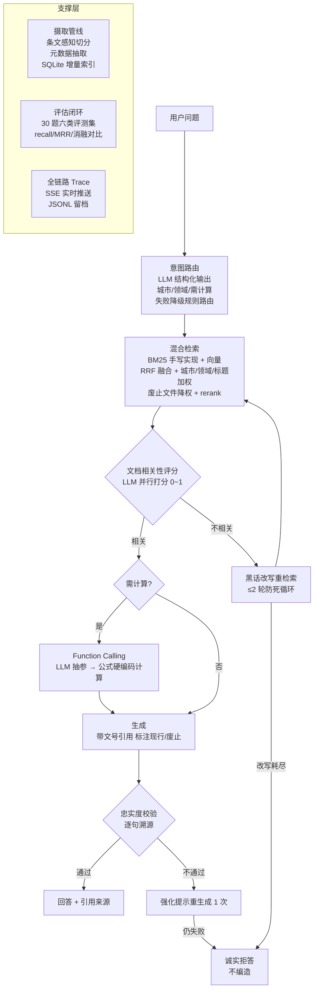

# 🧭 政策罗盘 PolicyCompass

> 跨城市社保/公积金政策的 **Agentic RAG** 问答服务 —— 把「Corrective RAG 自纠错检索 + Function Calling 精确计算 + 忠实度校验拒答」落成可运行、可评测、可部署的工程系统。
>
> 站在 [Datawhale《All in RAG》](https://github.com/datawhalechina/all-in-rag) 教程"四步构建 RAG"之上的业务化演进：教程教 RAG 基础，本项目补上教程尚未覆盖的 **Agentic RAG** 专题，并以政策问答这一强约束场景做深。

## 为什么是"政策问答"而不是又一个知识库 Demo

通用 RAG demo 的通病是**技术悬空**——没有任何业务约束强迫你做对什么。政策问答的每个技术设计都被业务事实逼出来：

| 业务事实（人人可验证） | 推导出的技术设计 |
|---|---|
| 同名政策各地不同：北京租房提取 2000/月、杭州 1500/月 | **意图路由 + 元数据过滤**：先识别城市/领域再检索，不带城市过滤必然答错城市 |
| 政策会修订废止（演示语料含 2022 已废止旧版 vs 2025 现行版） | 摄取期抽取**文号/生效日期/状态元数据**，检索期废止文件强降权、排序期现行优先 |
| 额度公式是确定的，LLM 心算不可靠，政策数字答错即事故 | **Function Calling 计算工具**：LLM 只做语义抽参，公式硬编码可复算（"确定性与模糊推理的边界"） |
| 用户说"断缴/跳槽/把公积金带走"，条文写"中断缴费/工作变动/转移接续" | **黑话词典 + 查询改写**，CRAG 循环里做业务化改写 |
| 问"拍车牌/退税"等库外问题，宁可拒答不能编 | **拒答分支 + 忠实度自检**，两次不通过强制降级为"给原文+建议热线" |

## 架构



## 核心特性（附面试考点）

| # | 特性 | 实现要点 | 面试常问 |
|---|---|---|---|
| 1 | **CRAG 自纠错编排** | LangGraph StateGraph：检索→评分→条件边改写循环→生成→忠实度校验→降级，量化信号驱动条件边 | 为什么需要 agent？循环怎么防死循环？ |
| 2 | **手写混合检索** | BM25（Okapi 公式逐行实现）+ 向量双路 → RRF 融合 → 城市/领域/标题事项名三级加权 → bge-reranker 重排（失败自动降级） | 为什么不用 LangChain Retriever？加权信号怎么来的？ |
| 3 | **中文分词粒度治理** | 实测踩坑："杭州市住房公积金"（文档）vs "杭州公积金"（查询）词面完全失配致 BM25 零命中 → 词 + CJK 字符 bigram 双通道索引（Lucene CJK 思路） | BM25 原理、idf 饱和、b 参数作用 |
| 4 | **Function Calling 工具层** | LLM 语义抽参（chat_json 自校验）→ 公式纯函数计算（三城规则）→ 同一工具经 MCP server 二次分发 | 工具调用完整流程？为什么不用原生 tools 参数？ |
| 5 | **政策时效管理** | 元数据（文号/生效日期/状态）摄取期抽取；检索期废止降权保留可查（能答"政策变了什么"）；文件 hash 增量热更新 | RAG 知识库热更新怎么做？ |
| 6 | **可靠性工程** | LLM 指数退避重试 / 结构化输出解析失败自校验纠错 / 评分失败保守记分 / rerank 失效降级 / 全局异常兜底 SSE error 帧 | 一环挂了系统会怎样？ |

## 快速开始

```bash
# 方式一：零配置体验（mock 模式，全链路可跑，无需任何 API key）
pip install -r requirements.txt
python scripts/serve.py
# 打开 http://127.0.0.1:8000 —— 打字机流式 + 实时 agent 决策路径面板

# 方式二：接入真实模型（推荐，出正式评测数字）
cp .env.example .env   # 填 LLM_API_KEY（DeepSeek/GLM/硅基流动）与 EMBED_API_KEY
python scripts/serve.py

# 方式三：Docker
docker compose up --build
```

CLI 演示（适合录屏）：
```bash
python scripts/chat.py "我杭州公积金余额4万缴了5年月薪2万，最多能贷多少？"
```

## 评测（一键复现）

```bash
python scripts/eval.py            # 检索指标 + 消融 + 端到端，产出 docs/eval_report.md
python -m pytest tests/ -q        # 22 项测试（mock 模式，零 API key 可跑 CI）
```

**正式口径**：`deepseek-v4-flash-0731`（阿里云百炼）+ BM25 混合检索（embedding 额度不可用，`EMBED_ENABLED=false` 向量路休眠，架构支持一键恢复）+ 33 题六类评测集（含 2 份真实政策文件的事实题）。完整报告见 [docs/eval_report.md](docs/eval_report.md)。

**检索消融**（29 题含目标文档集）：

| 配置 | recall@5 | MRR | 已废止文件泄漏进 Top5 |
|---|---|---|---|
| BM25 纯净 | 94.8% | 0.822 | 0 |
| **BM25 + 业务加权（本系统）** | 93.1% | **0.828** | **0** |

> 数字解读：真实语料（当前无废止文件）下两组基本持平，加权带来 MRR +0.006；**时效降权的核心价值（废止泄漏 2→0）在含新旧版本对的语料上得到验证**（见 git 历史评测），并由单元测试覆盖。城市/标题加权解决的是"同名政策跨城串答"，其价值体现在端到端事实题 9/9 全对。

**端到端行为指标**（33 题 × 6 类）：

| 题型 | n | 通过率 | 说明 |
|---|---|---|---|
| 事实题 | 9 | 100% | 含 3 道真实政策文件题（2000元/月、封存半年、小额提取免公证书） |
| 对比题 | 4 | 100% | 跨城多文档召回 + 数字齐全 |
| 计算题 | 6 | 100% | Function Calling 额度精确（60/100/80/50/30/120 万） |
| 拒答题 | 4 | 100% | 库外问题（拍车牌/退税/护照/创业补贴）零编造 |
| 黑话题 | 6 | 83.3% | 断缴/跳槽/带走 → 规范条文 |
| 时效题 | 4 | 75% | 真实模型评分抖动导致的 2 例误拒答为当前主要损失 |
| **总体** | 33 | **93.9%** | P50 延迟 16.2s（真实模型链路 8~9 次调用） |


## API 一览

| 方法 | 路径 | 说明 |
|---|---|---|
| POST | `/api/chat` | 问答（`stream: true` 返回 SSE：meta→trace→token→done） |
| GET | `/api/documents` | 文档列表（含状态/文号/城市元数据） |
| POST | `/api/documents` | 上传摄取（增量，自动重建索引） |
| DELETE | `/api/documents/{id}` | 删除并级联清索引 |
| POST | `/api/ingest/sync` | 重扫语料目录（政策热更新） |
| GET | `/api/health` · `/api/stats` | 健康 / 运行统计（token、重试、JSON 修复率、拒答数） |

## 设计取舍 FAQ

**为什么 SQLite + numpy 而不是 Milvus/Chroma？**
目标规模数千 chunk，numpy 暴力余弦 <5ms，独立向量库反而增加部署复杂度。检索层只依赖 `chunks()`/`matrix()` 两个方法，规模上万后平滑替换 Milvus 适配层。

**为什么 LangGraph 之外还有一个"手动流式"路径？**
LangGraph 原生流式只到节点粒度。`POST /api/chat?stream=true` 复用**同一组节点函数**驱动前置阶段，生成节点交由 `llm.chat_stream` 做 token 级推送，流毕执行 verify（不通过推 correction 帧替换答案）。节点函数是唯一真相源，图与非流式行为一致——框架服务需求，而非反过来。

**为什么工具调用用 chat_json 而不是原生 tools 参数？**
不是所有 OpenAI 兼容端点都稳定支持 tools；且 chat_json 链路已有"解析失败→错误回灌→重试"的自校验，参数错误率可控可观测（`/api/stats` 的 json_first_pass_failure_rate）。

**rerank 挂了会怎样？**
捕获异常 → 跳过重排用 RRF 融合序（`stats.rerank_fallbacks` 计数），主链路无感。

## 与 All-in-RAG 教程的关系

- 教程[第四章](https://datawhalechina.github.io/all-in-rag/)讲混合检索原理 → 本项目给出**带业务加权信号与消融数字的工程实现**；
- 教程第六章讲评估方法论 → 本项目给出**六类 30 题评测集 + 四组消融 + 一键报告**的闭环；
- 教程 Extra-chapter 欢迎社区投稿 **Agentic RAG** 专题 → 本项目即是该专题的一个完整参考实现（CRAG 编排 + 拒答 + 工具调用）。

## 目录结构

```
policy-compass/
├── app/
│   ├── llm/          # OpenAI 兼容客户端（重试/SSE/自校验）+ 确定性 mock
│   ├── ingestion/    # 条文感知切分 / 元数据抽取 / SQLite 增量索引
│   ├── retrieval/    # 手写 BM25 / RRF 混合检索 / rerank 降级
│   ├── agent/        # 意图路由 / Function Calling 工具 / LangGraph CRAG
│   ├── api/          # FastAPI SSE / 文档管理 / 统计
│   ├── eval/         # 指标 + 消融 + 报告
│   └── obs/          # trace JSONL
├── data/corpus/      # 18 篇政策语料：含 2 份真实红头扫描件 PDF（杭房公委〔2023〕8号/〔2025〕4号，视觉 OCR 摄取）+ 其余演示文档
├── data/eval_set.jsonl  # 30 题评测集
├── mcp/server.py     # 计算工具的 MCP 暴露（可选 pip install "mcp[cli]"）
├── static/index.html # 演示前端（打字机 + trace 面板）
├── scripts/          # serve / ingest / eval / chat
└── tests/            # 21 项 pytest
```

> 语料声明：`data/corpus` 中**杭州租赁提取垂直已替换为真实政策原文**（[杭房公委〔2023〕8号](https://file.m12333.cn/upfile/download/71732f5a-856d-0146-4324-abf02115af01.pdf)、[〔2025〕4号](https://file.m12333.cn/upfile/download/d8f09351-9388-a863-1de2-0b17190b8a0a.pdf)，红头扫描件 PDF 经视觉 OCR 摄取，工具限额表/评测集已对齐真实数字 2000元/月）；其余文档仍为按真实结构编写的演示数据，接入生产请整体替换为官方发布文本。
>
> **扫描件解析**：pypdf 对红头扫描件抽取文本近于零（实测 4 页 3 字符），摄取管线自动降级视觉模型 OCR（`app/ingestion/ocr.py`），结果按文件哈希缓存于 `data/ocr_cache/`。

## Roadmap

- [ ] rerank 后的查询子问题并行检索（对比型问题拆分检索再融合）
- [ ] Langfuse 接入（当前自研 trace 的生产化替代）
- [ ] 对比型问题的多路城市子查询（当前靠加权解决）
- [ ] 政策"新旧差异"专门回答模式（已废止文件单独成块）
