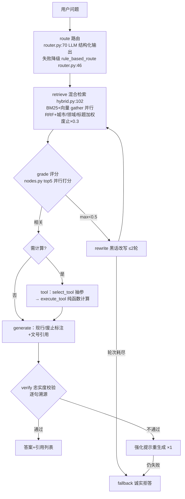

# PROJECT BOOK · 政策罗盘 PolicyCompass —— 跨城市社保公积金 Agentic RAG 问答系统

> 配套：[README](../README.md)（架构图+评测口径）｜[EVIDENCE](../EVIDENCE.md)（完整证据链）｜[CODE_GUIDE.md](CODE_GUIDE.md)（四步内化指南）｜[ablation.md](ablation.md)（向量腿消融）
> 本书行号引用以当前代码为准（核心锚点逐一核对过）；数字为现行冻结口径（2026-11-02 PC-3 复测后）。

---

## 0. 一页定位

### 0.1 是什么（一句话）

面向社保/公积金政策咨询的 **Agentic RAG 问答服务**：CRAG 自纠错检索（评分→黑话改写→重检索的有界循环）+ 手写混合检索（BM25+向量+RRF+三级业务加权）+ Function Calling 额度精算 + 忠实度校验拒答，**可运行、可评测（v1 33 题/v2 90 题分层+holdout）、可部署（Docker/Render）**。

### 0.2 回答哪道面试必答题

面经检索结论（interview/mianjing/00）："普通 RAG 知识库烂大街+被『夺命十连问』专打"；高频真题直击本项目腹地——**"Agentic RAG 和传统 RAG 区别？""如果 BM25 已经很好，向量检索还有必要吗？""Recall@5 是 0.81，你怎么知道这个数字是好是坏？baseline 是什么？""解决后有没有评测数据证明有效？"**。本仓库是这四道题的**可运行答案**：区别=CRAG 循环+工具+校验（graph.py）、必要性=消融数字（docs/ablation.md）、好坏=分层评测+holdout 纪律、有效=每次修复前后全量复测。

### 0.3 组合叙事（五仓各占一环）

**检索增强（本仓库）** → 工具编排/多 Agent（askbi）→ 底层引擎（miniagent）→ 评测量化（agenteval）→ 认知记忆（memomind）。本仓库贡献的是"**业务约束驱动的检索设计 + 评测驱动修真 bug 的完整闭环**"——agenteval 的 CI 门禁基线就建在本仓库的 mock 环境上（见 ablation.md §3）。

### 0.4 简历一句话版

跨城市社保公积金 Agentic RAG（LangGraph CRAG+手写混合检索+FC 计算+忠实度拒答）：v2 90 题真模型 93.3%（refuse 12/12 零编造）、v1 33 题 100%（33/33）、检索 recall@5 97.9%/97.2%、废止文件零泄漏、故障注入 61 次编造=0、29 项 pytest；评测驱动修出黑话扩展 df 命中≈0 的上线级真 bug。

---

## 1. 技术栈全景（每一层"选了什么、为什么、放弃了什么"）

| 层 | 选型 | 为什么 | 被否掉的方案及原因 |
|---|---|---|---|
| 编排 | LangGraph 0.2 StateGraph（agent/graph.py:56） | 需要显式条件边（graph.py:36 评分阈值分流）+ 有界循环（改写≤2 轮）+ 事件流 | Dify 低代码做不了条件循环/token 级流式接管；AutoGen/CrewAI 面向多 agent 对话，本项目是单 agent 多阶段流水线 |
| LLM 接入 | httpx 手写 OpenAI 兼容客户端（llm/client.py:81） | 讲清协议本质（一次 POST/SSE `data:` 行）；重试/超时/结构化纠错自主可控（client.py:94 `_post_with_retry`） | openai SDK（屏蔽协议细节）；本项目 CI 零 key 可跑全靠 mock 替身继承真实客户端 |
| 主模型 | deepseek-v4-flash-0731（百炼） | 每问 8~9 次调用（路由/评分×5/生成/校验）用快速档控成本；OCR 用 qwen3-vl-plus | — |
| 检索-稀疏 | 手写 Okapi BM25（retrieval/bm25.py:70） | 逐行实现才讲得清 idf 饱和、b 参数；且需要词权入口支撑黑话扩展 0.6 权重（hybrid.py:80 `expand_query`） | rank_bm25（黑盒、无词权入口） |
| 中文分词 | jieba 词 + CJK bigram 双通道（bm25.py:27/:48） | 实测踩坑：文档"杭州市住房公积金"整词 vs 查询"杭州公积金"粒度失配 → BM25 零召回；bigram 消除失配 | 纯 jieba（失配复现）；纯 bigram（丢词级语义） |
| 检索-稠密 | OpenAI 兼容 /embeddings，`EMBED_ENABLED` 开关（config.py:38） | **向量腿是否值得开由消融数据回答**（docs/ablation.md），不拍脑袋 | 常开（额度+质量未证明前是纯成本）；砍掉架构（降级应该是设计出来的） |
| 融合 | RRF k=60 + 三级业务加权（hybrid.py:173 `_rrf_fuse`） | 城市×1.8/领域×1.3/标题事项名×1.6/废止×0.3——每个系数对应一条业务事实 | 纯 RRF（跨城同名政策张冠李戴）；加权系数进消融可关（eval/runner.py:95） |
| 存储 | SQLite + numpy 内存矩阵（ingestion/indexer.py:224 `load_cache`） | 数千 chunk 暴力余弦 <5ms；单文件零部署；检索层只依赖 `chunks()/matrix()` 两接口 | Milvus/Chroma（规模过万再换，README FAQ） |
| 服务 | FastAPI + SSE 手写帧协议（api/） | token 级流式 + trace 事件实时推送；节点函数是图与流式唯一真相源 | WebSocket（单向流式用不上） |
| 生态 | FastMCP（mcp/server.py） | 同一套计算工具进程内服务 LangGraph、经 stdio 服务外部生态 | — |
| 评测 | 自研 runner（eval/runner.py） | 检索指标确定性（不依赖 LLM）+ 端到端分题型判分 + 消融可关每个信号 | Langfuse 等（观测可接，评测分层逻辑是业务自有） |

---

## 2. JD 要求映射表（JD/真题原文 → 代码位置 → 面试指路一句话）

| JD/真题原文（来源：interview/mianjing/00） | 对应实现 | 面试指路一句话 |
|---|---|---|
| "RAG/向量库"（JD 词频第一：8+11/30） | retrieval/ 全目录 | "BM25 逐行实现+bigram 双通道+RRF 融合+业务加权，每个设计被一条政策业务事实逼出来" |
| 字节真题："**如果 BM25 已经很好，向量检索还有必要吗？**" | docs/ablation.md（向量腿消融） | "我不站队，我消融：BM25 纯净 97.9% vs 生产加权 97.2%，向量腿贡献见消融报告——结论是 X pp，值不值一眼看出" |
| 字节真题："Recall@5 是 0.81，怎么知道好坏？baseline 是什么？" | eval/runner.py:57 + v1/v2/holdout 分层 | "三个 baseline：自身消融（关掉每个信号比）、冻结回归集（改动只许升不许降）、holdout 15 题永不参与调参" |
| 大厂题库："**Agentic RAG 和传统 RAG 区别？**" | agent/graph.py:36 条件边 + nodes.py:52 | "区别在自纠错：评分不过→黑话改写→重检索（≤2 轮），生成后忠实度校验不过→重生成→仍败→拒答——量化信号驱动条件边，不是 prompt 里写'请仔细想想'" |
| 字节真题："为何 ES+BM25 混合检索、优化多少怎么测？" | eval/runner.py:95 `ablation()` | "消融四组+生产对照，每组 recall@5/MRR/废止泄漏三指标；黑话扩展修复 95.9→97.9 就是这么测出来的" |
| 大厂题库："解决后有没有评测数据证明有效？" | EVIDENCE §4 PC-3 节 | "每次修复全量复测冻结口径：v1 33 题 100%、v2 93.3% 与冻结持平、失败集逐条归因——数字在最后一笔提交之后生成" |
| "Function Calling/Tool Use"（5+/30） | agent/tools.py:266 `select_tool` + :230 `execute_tool` | "语义抽参（chat_json 自校验+防御性转换）与纯函数计算严格分离，公式硬编码可复算，同一工具经 MCP 二次分发" |
| "幻觉缓解"（原理八股持续在考） | nodes.py verify 节点 + fallback | "生成后逐句溯源校验，不通过重生成 1 次仍失败→拒答；故障注入 61 次编造=0 是注入出来的证据不是口号" |
| "MCP"（2→硬性筛选） | mcp/server.py | "同一套工具函数双分发：进程内给 LangGraph、stdio 给外部生态" |
| "政策会修订废止"业务难点 | indexer.py 元数据 + hybrid.py:225 废止×0.3 降权 | "摄取期抽文号/生效日期/状态，检索期强降权保留可查——废止泄漏 0 由单测钉死" |

---

## 3. 全流程实现走读（一次 `/api/chat` 的完整生命）

**逐步精读**（模块:行号 + 它防的坑）：

1. **路由**（router.py:70 `route_query`）：chat_json 自校验抽 `{city, domain, need_calc, sub_questions}`；LLM 失败→`rule_based_route`（router.py:46）正则兜底——**规则路由同时是检索评测的对照组**（隔离 LLM 变量）。多城问题路由为"全国"并拆 sub_questions。
2. **查询扩展**（hybrid.py:80 `expand_query`）：黑话词典命中→规范词 0.6 权重注入；注入词**必须先过 tokenize_words 归一**（PC-3 真 bug 修复点：此前整串短语在 df 查找中静默失效，feature 自上线空转，见 §5 问 8）。
3. **双路并行**（hybrid.py:119-124）：BM25（CPU，run_in_executor）与向量（网络）`asyncio.gather` 并行，延迟≈max 非求和；向量路关闭时查询向量落零向量被 norm==0 过滤（hybrid.py:164）——**降级是数据流里设计出来的，不是 try/except 补丁**。
4. **RRF 融合+业务加权**（hybrid.py:173 `_rrf_fuse`）：`1/(k+rank)` 基础分（向量路带 0.8 置信权重）→ 城市×1.8（含多城问法直接对照 chunk.city，hybrid.py:204）/领域×1.3/标题 bigram 重叠×1.6/废止×0.3。
5. **CRAG 评分**（nodes.py `make_nodes` grade）：top5 并行 LLM 打分（锚点 0.85~1.0/0.6~0.8/0.2~0.4/0~0.1），单条 8s 超时，失败记保守 0.3——**评分链路被打断时宁可少答**。
6. **条件边**（graph.py:36 `_after_grade`）：max<0.5→rewrite（黑话改写+语境补全）→回检索，≤2 轮（graph_recursion_limit=20 兜底）；耗尽→fallback。
7. **工具调用**（tools.py:266 `select_tool` LLM 抽参 → tools.py:200 `_coerce_args` 防御性转换：别名归一/"4万"→40000/未知键丢弃/缺 city 路由回填 → tools.py:230 `execute_tool` 纯函数）：**LLM 碰不到公式**；tools.py:28/:44 的 RENT_LIMITS/LOAN_RULES 与语料原文逐字一致（沪〔2026〕1号首套 100/200 万、杭〔2026〕1号月均余额×20 倍 90/180 万）。
8. **生成**（nodes.py generate）：prompt 硬约束——只依据资料、[n] 标注引用、现行/废止区分、计算必须用工具结果；上下文带文号+生效日期+条款号（PC-3 引用定位特性，chunk 级 sections/pages 元数据）。
9. **忠实度校验**（nodes.py verify）：逐句溯源，程序性兜底话术（"建议拨打 12329"）豁免；不通过→强化提示重生成 1 次→仍失败→fallback 拒答。
10. **可观测**：全程 `_ev` 事件（nodes.py:27）SSE 实时推送 + JSONL 落档（obs/）；`/api/stats` 暴露 token/重试/JSON 修复率/拒答数。

---

## 4. 代码内化路线（按序读，每步带验证；重写关卡在 §4.9）

> 系统版四步法（含时间盒）见 [CODE_GUIDE.md](CODE_GUIDE.md)；本书给依赖序路线，两者配合用。

### 4.1 `tests/`（先读规格）
带着问题：mock 替身怎么继承真实客户端？判分按题型怎么分？
**动手**：`POLICY_COMPASS_FORCE_MOCK=1 python -m pytest tests/ -q`（29 项全绿，零 key）。

### 4.2 `app/retrieval/bm25.py`（检索的地基）
**自测题**：① idf 饱和是什么、公式里哪个参数压住它？② `tokenize` 为什么词+bigram 双通道都要？③ `search_weighted` 的词权入口给谁用？

### 4.3 `app/retrieval/hybrid.py`（全场心脏，200 行）
**自测题**：① 向量路关闭时 `_vector_search` 为什么返回空而不抛异常？② RRF 里向量路为什么乘 0.8（config.py:66）？③ 三个 boost 系数删掉哪个对评测影响最小？（答：跑 ablation，别猜）

### 4.4 `app/ingestion/`（切分与元数据）
splitter.py:54 按条文聚合 + indexer.py:161 `_ingest`（embed 输入=`title\n{text}`）+ metadata.py 脏文本正则兜底。
**自测题**：① 为什么"第X条"不限长（真实公文长条文实测限长整批漏标）？② 文件 hash 未变时 sync 跳过——索引怎么热更新？

### 4.5 `app/agent/`（编排+工具）
router.py → nodes.py → graph.py → tools.py，按调用序读。
**自测题**：① 为什么工具的抽参和计算分离成两个函数？② `_coerce_args` 防的是真实模型的哪三类行为？③ 条件边为什么只看量化信号？

### 4.6 `app/llm/`（协议层）
client.py:194 `chat_json` 的"解析失败→错误回灌→重试 2 轮"链路；mock.py 继承 LLMClient 只覆写网络层——**CI 里的编排链路是被完整执行的，不是被绕过的**。
**自测题**：① mock embed 为什么必须对齐 embed_dim？② `llm_trust_env=False` 防的什么坑（Windows 注册表代理，EVIDENCE §③-3）？

### 4.7 `app/eval/runner.py`（评测闭环）
`eval_retrieval`（确定性指标）→ `ablation`（信号逐个关）→ `eval_end2end`（分题型判分）。
**自测题**：① 为什么检索指标用规则路由？② 判分为什么用完整答案、展示才截断 200 字（mock 误判 10 条的真 bug）？

### 4.8 `scripts/`（复现层）
eval.py 一键报告 / fault_inject.py 61 次注入 / load_test.py 压测 / ablation_vector.py 向量腿消融三阶段。

### 4.9 重写关卡（内化完成的硬验收）
三关（CODE_GUIDE 第二步脱稿手写清单 + practice/ 练习场）：
1. **手写 BM25**（bm25.py 全量）：Okapi 公式+双通道 tokenize+weighted 打分，跑通 `tests/test_retrieval*.py`；
2. **手写 CRAG 主循环**（graph.py+nodes.py 骨架）：条件边+有界改写循环+fallback，白板能画全图含失败分支；
3. **消融复现**（eval/runner.py:95）：蒙住源码写出"关掉一个检索信号"的正确姿势（settings 捕获-改-还原四步），复跑出 §0.2 的数字。
**验收标准**：① 白板画出 `/api/chat` 全链路图（含 verify 失败分支与拒答路径）② §5 十问全部脱口而出带行号带数字 ③ 三关重写对应测试全绿。

---

## 5. 深挖 10 问（每问：问题 → 代码锚点 → 标准答案带数字）

**问 1：为什么 SQLite+numpy 不用 Milvus/Chroma？**
锚点：indexer.py:224 `load_cache`（内存归一矩阵）。
答：目标规模 68 chunk（数千以内），暴力余弦 <5ms，单文件随仓库分发零部署；检索层只依赖 `chunks()/matrix()` 两接口（hybrid.py:157-158 只用这两个），规模过万平滑换适配层。**向量库是规模问题不是 RAG 必要件**。

**问 2：如果 BM25 已经很好，向量检索还有必要吗？**（字节真题，本项目消融直接回答）
锚点：eval/runner.py:95 `ablation` + docs/ablation.md。
答：不站队，消融说话：v2 78 题上 BM25 纯净 97.9%/BM25+业务加权 97.2%（MRR 0.949、废止泄漏 0，2026-11 复跑与冻结一致）；真实 embedding（text-embedding-v4）混合腿=recall@5 98.1%（+0.9pp）、**MRR 0.984（排序质量真增益）**、端到端 mock +2.2pp/#177/#189 脆性题救回、泄漏仍 0——**结论：值得保（MRR 与 e2e 增益一致为正），recall@5 单指标弱增益，生产默认开启留决策**（前置=真模型复测+门禁基线重建，见 ablation.md §4）。另有一个口径发现：FORCE_MOCK 环境下 mock 哈希向量腿实际在跑且拖低 recall@5 至 93.8%——**"BM25-only"必须分清生产口径（真关）与 mock 口径（哈希向量在跑）**，CI 门禁基线属后者，见 ablation.md §3。

**问 3：Agentic RAG 和传统 RAG 的区别到底是什么？**
锚点：graph.py:36 `_after_grade` 条件边 + nodes.py rewrite/verify。
答：三点——①**检索自纠错**：评分 max<0.5 触发黑话改写重检索（≤2 轮有界循环）；②**计算外置**：确定性公式走 FC 纯函数（tools.py:230），LLM 只做语义抽参；③**生成后校验**：忠实度逐句溯源，失败重生成→拒答。传统 RAG 是"检索→塞 prompt→生成"单向流，错了没有第二道闸。

**问 4：怎么保证不编造（幻觉治理）？**
锚点：nodes.py verify + fallback + scripts/fault_inject.py。
答：四层——①检索层废止降权防旧文件冒充现行；②生成 prompt 硬约束"只依据资料+[n] 标注"；③verify 逐句溯源+重生成一次；④库外问题路由识别→诚实拒答（v2 refuse 12/12 零编造）。**证据是故障注入 61 次编造=0**（5 场景：LLM 全挂/评分链路断/工具挂/超时/脏输出），不是"我们很小心"。

**问 5：Function Calling 为什么手写 chat_json 不用原生 tools 参数？**
锚点：llm/client.py:194 `chat_json` + tools.py:200 `_coerce_args`。
答：①不是所有 OpenAI 兼容端点都稳定支持 tools（国产端点实测）；②自校验链路（解析失败→错误回灌→重试 2 轮→StructuredOutputError）让参数错误率可观测（/api/stats json_first_pass_failure_rate）；③防御性转换接住真实模型的真实行为：自创别名 salary→monthly_income、"4万"→40000、缺 city 路由回填——工具成功率恢复 100%。

**问 6：加权系数 1.8/1.3/1.6 哪来的？会不会在评测集上调参过拟合？**
锚点：hybrid.py:173 + eval_set_v2.jsonl `split:"holdout"` 15 条。
答：系数各自对应一条业务事实（同名政策城市差异/领域混检/标题即事项名），不是网格搜索出来的；**是否过拟合由 holdout 回答**：15 条在构建期随机抽出、永不参与任何调参、报告单列（v2 holdout 93.3% 与 main 同分）；消融表上 ±0.7pp 的差距明确标注"小样本噪声级、不在 mock 噪声量级上调参"（EVIDENCE §4）。

**问 7：mock 评测可信吗？mock 和 real 数字为什么差这么多？**
锚点：llm/mock.py:35（继承 LLMClient 只覆写网络层）+ EVIDENCE §4 mock/real 分列。
答：mock 验证的是**链路与判分机制**（编排/重试/工具调用在 CI 被完整执行），real 才是质量口径——两者严格分列从不混写（v2 mock 91.1% vs real 93.3%）。mock 的已知失真也诚实记录：抽形式判分有词面脆性（#177/#179/#189 三条 mock 失败真模型探针 5/5 通过）。**mock 的价值是回归裁判**：改动后 5 分钟确认老题不回归。

**问 8：讲一个你评测驱动修出来的真 bug。**（高频叙事题，背熟）
锚点：hybrid.py:80 `expand_query` 注释 + EVIDENCE §4 PC-3 节。
答：黑话词典扩展自上线近乎空转——扩展词（"委托提取还贷"等整串短语）未经分词归一直接注入，在 BM25 的 df 查找中**静默失效**（实测扩展词 df 命中率≈0，只有恰好是 jieba 原生 token 的词生效），slang 历史通过属排序巧合。评测复测暴露 → 修复=注入词先过 tokenize_words（df 命中 100%）→ recall@5 95.9/95.3→97.9/97.2 → v1 real 100%（历史 2 例误拒消解）。**教训：feature 上线要有证明它活着的指标**。

**问 9：废止文件泄漏怎么治理的？**
锚点：metadata.py 状态抽取 + hybrid.py:225 `invalid_doc_penalty`×0.3 + runner.py:75 `stale_leaks` 指标。
答：摄取期抽文号/生效日期/状态元数据；检索期废止×0.3 强降权但**保留可检索**（能答"政策变了什么"）；评测把"废止不得进 Top5"定为硬指标（not_expect_docs），历史语料泄漏 2→0，当前所有配置泄漏 0，单测覆盖。这答的是 RAG 时效性：知识库更新滞后期间系统如何自保。

**问 10：延迟 15s、100 万人用，最先崩哪？**
锚点：EVIDENCE 压测两轮 + graph 每问 8~9 次 LLM 调用。
答：瓶颈在 LLM 串行调用不在检索（检索 <5ms）：①评分 5 路并行已做，下一步只评 top3/批量接口/换小模型评分类；②高频问题缓存（政策查询重复率高）；③无状态服务层多副本水平扩，SQLite 单写不是瓶颈（读全走内存矩阵）。P50 15s 是"每问 8~9 次推理模型调用"的正常水位，压两轮 mock 压测（零延迟 500×3 档+模拟延迟 1.5s×150×3 档）定位的是 HTTP 栈上限而非 LLM 容量——口径不混。

---

## 6. 边界与演进（诚实声明）

- **向量腿现状**：生产 `EMBED_ENABLED=false` 运行（历史 embedding 额度不可用）；架构一键可开（config.py:38）。**消融结论（2026-11-05，真向量实测）**：混合腿 v2 recall@5 98.1%/MRR 0.984/e2e mock +2.2pp/泄漏仍 0——MRR 与 e2e 增益为正、recall@5 弱增益，**保留架构、生产默认开启留主人决策**（前置清单 ablation.md §4）；FORCE_MOCK 环境的"向量路"是哈希词面向量（mock.py 模块头自述），仅链路验证非质量证据（ablation.md §3 三口径表）。
- **语料**：23 份中 16 份真实文件（7 城+全国，头部注明 source_url）、7 份演示文档（头部声明，官方文件发布后按流程替换）。
- **真模型残余损失**：v2 real 6 条未过（2 评分抖动误拒+1 保守误称未收录+3 金标写法变体，post-hoc 并入写法变体 96.7%——正式口径仍以冻结金标 93.3% 为准，不重跑不改口径）。
- **压测边界**：单副本 uvicorn 本机 HTTP 栈，不代表生产容量（多 worker/多副本需重测）。
- **演进**：①对比题子问题并行检索；②高频问题缓存；③评分/校验换小模型；④7 份演示文档持续真实化；⑤若消融证明向量腿有价值→生产开启+重跑冻结口径全量复测（最后一笔提交之后）。
