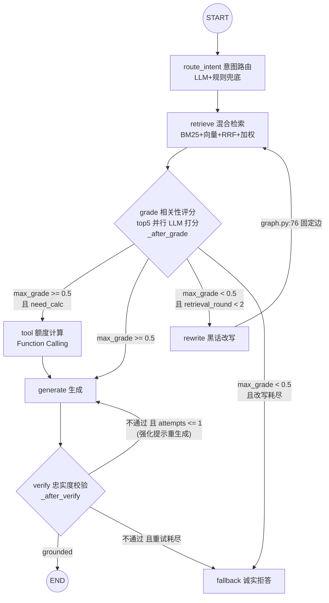

# L2 · CRAG 循环精读：评分、改写重检索、忠实度校验与诚实拒答

> 精读对象：`app/agent/graph.py`（约 114 行）+ `app/agent/nodes.py`（约 392 行）+ `app/config.py` 编排段（config.py:74-78）。
> 配套测试：`tests/test_tools_graph.py`（计算路径/拒答路径/循环有界/规则路由四条端到端锚点）。
> 本项目自述（graph.py:1）：LangGraph 把自纠错检索（Corrective RAG）落成可运行的状态机。

---

## 0. 全景拓扑（graph.py:3-18 docstring 的等价 mermaid）



**条件边决策全部依据量化信号**（grade 分数、attempt 计数），不是模型自由发挥；循环边界由 `max_query_rewrites=2` 与图级 `recursion_limit=20` 双重保证（graph.py:17-18；config.py:76, 78）。

---

## 1. 两个条件边函数（graph.py:36-53）

```python
def _after_grade(state) -> Literal["tool", "generate", "rewrite", "fallback"]:
    docs = [d for d in state["documents"] if d.get("grade") is not None]
    max_grade = max((d["grade"] for d in docs), default=0.0)
    if max_grade >= settings.grade_threshold:            # 0.5, config.py:75
        return "tool" if state["route"].get("need_calc") else "generate"
    if state.get("retrieval_round", 0) < settings.max_query_rewrites:
        return "rewrite"                                  # graph.py:43-44
    return "fallback"                                     # 改写耗尽 → 诚实拒答
```

读法：**取评分过的文档里的最大分**判断"库里有没有能答题的料"。`grade is None` 的文档（超出 top_k_final 未评分的）被排除——它们从未被评审过，不能贡献分数。

`_after_verify`（graph.py:48-53）三分支：`verified` → END；`generation_attempts <= max_generate_retries(=1)` → 带强化提示回 generate；耗尽 → fallback。注意判断条件是 `<=`：attempts 在 generate 里已自增（nodes.py:297），所以首次生成后 attempts=1，失败再给一次机会（第二次生成 attempts=2 > 1）才降级。

---

## 2. grade：并行评分与"保守分"（nodes.py:117-166）

```python
async def grade_one(doc: dict) -> float:
    try:
        async with asyncio.timeout(8):                    # 单条 8s 超时
            g = await llm.chat_json([...锚点 prompt...], GradeResult)
        doc["grade"] = g.score
    except (StructuredOutputError, LLMError, TimeoutError):
        doc["grade"] = 0.3  # 保守分：评分失败不惩罚检索、但不会误判为强相关
    return doc["grade"]

grades = await asyncio.gather(*(grade_one(d) for d in docs))   # top_k_final=5 路并行
```

三个可靠性细节：

1. **锚点校准写在 prompt 里**（nodes.py:127-131）：直接依据（具体标准/数字/公式）=0.85~1.0；仅覆盖一部分=0.6~0.8；仅沾边=0.2~0.4；无关=0~0.1。附"同一文档常含多条条文，一条能答即高分"。这是**阈值校准踩坑**的修复现场（PROJECT_BOOK 踩坑实录第 4 条）：早期锚点过松，0.4~0.5 的分数卡在阈值上下抖动造成误拒 → 锚点收紧后同类题 0.7~1.0，端到端 80%→93.9%。**教训：阈值不是一个数字，是一段锚点文本+阈值数字的整体校准。**
2. **评分失败记 0.3**：0.3 < 0.5 阈值，方向是"推向 rewrite/fallback"而不是放行——宁可不选，不可错选（nodes.py:141-143 注释）。单条 8s 超时防止一个慢 chunk 拖死整轮。
3. **并行而非串行**：5 路 gather，评分段 ~5s 而不是 ~25s（PROJECT_BOOK 第 93 行的延迟账）。

---

## 3. rewrite：LLM 改写 + 词典级兜底（nodes.py:168-205）

改写 prompt 的定位（nodes.py:174-178）：把口语黑话（断缴/跳槽/把公积金带走）改写为规范政策用语（中断缴费/工作变动/转移接续），**不要回答问题，只输出改写**。

兜底链（nodes.py:189-192）：LLM 改写失败（结构化输出不可恢复）→ 直接用 `retriever.expand_query(question)` 的词典扩展词拼接作为新查询——检索侧的黑话处理（L1 §2）在这里成了改写节点的兜底，两层防线互为备份。

改写成功 → `retrieval_round += 1`（nodes.py:196）→ 回 retrieve。循环有界：`_after_grade` 里 `retrieval_round < max_query_rewrites(=2)` 不满足即 fallback；再加图级 `recursion_limit=20`（config.py:78，graph.py:104）双保险——测试锚点 tests/test_tools_graph.py:68-75（"拍车牌摇号"库外题，rewrite 事件数 ≤2 且无死循环）。

---

## 4. generate → verify：忠实度闭环（nodes.py:234-356）

### 4.1 生成上下文的组装（build_generation_messages，nodes.py:234-270）

- 参与生成的文档过滤：`grade is None or grade >= 0.4`（nodes.py:236-237）——注意是 **0.4 不是 0.5**：0.4~0.5 之间"部分沾边"的文档允许进上下文当背景，但不够格让 grade 条件边放行；
- 每条资料带元数据行（城市·领域·文号·生效日期·现行有效/已废止，nodes.py:241-244）——已废止文件标注"仅作历史参考"（generate 的 system 规则 3：仅找到废止文件须明确提示，nodes.py:261）；
- 工具结果以"【计算工具结果（已按公式精确计算，直接采用）】"硬注入（nodes.py:247-249）——**计算必须采用工具数字，禁止模型心算**；
- 生成 temperature=0.2（nodes.py:281）。

### 4.2 verify（nodes.py:309-356）

结构化输出 `VerifyResult(grounded, unsupported)`。prompt 的两个校准点：
- 逐句检查每个**实质性结论**（数字、额度、条件、流程）能否在资料/工具结果中找到支持（nodes.py:324-327）；
- **程序性、兜底性表述不算无出处结论**："建议拨打12329/12333""以当地中心为准"是服务规范而非事实断言（nodes.py:328-329）。这是踩坑实录第 5 条的修复——早期 verify 把这类话术误杀为编造。

失败路径：verify 不过 → generate 的强化提示"每一句结论都必须能在参考资料中找到出处，宁少勿错"（nodes.py:276-280）→ 再不过 → fallback。**校验器自身失效（LLM 挂了）时 grounded=True 放行**（nodes.py:338-339）——校验器失效不应阻塞主链路，这和 grade 失败记 0.3 的保守方向**相反**：一个错放行只是"少一道保险"，一个错拦截会误杀好答案，两个默认值各自对准自己的错误成本。

### 4.3 fallback：诚实拒答（nodes.py:358-379）

两种文案：库里检索到过"最接近"的文件 → 报文件名+文号+热线建议（12329/12333）；完全无关 → 明说未收录（举例外：车牌拍卖、个税、护照）+ 12345。`stats.incr("refusals")` 记数。测试锚点 tests/test_tools_graph.py:59-65（"护照到期怎么换证"→ refusal=True、answer 含 12329/12345）。

**降级而非编造**是整个 CRAG 循环的价值主张：政策问答答错数字即事故（nodes.py:5-6），所以循环的每个出口都通向"更保守"而不是"更自信"。

---

## 5. route 与 tool：循环的入口与岔路（简要，详见练习与 L3）

- `route_intent`（nodes.py:53-71 → router.py:70-98）：LLM 结构化路由 city/domain/need_calc/sub_questions，失败降级 `rule_based_route`（router.py:46-67，确定性正则）——路由错误率因此有界；
- `tool`（nodes.py:207-232）：`select_tool` LLM 抽参数 → `execute_tool` 纯函数执行（tools.py:196-205）；模型常省略 city，用路由结果回填（nodes.py:215-219，"缺失参数靠硬编码兜底而非指望模型自觉"）。

---

## 6. 常见错误实现对比

| 错误写法 | 后果 | 正确做法（源码位置） |
|---|---|---|
| 检索完直接生成（无 grade） | 召回噪声直接进答案，无法区分"库里没有"与"没检索到" | grade 条件边 + rewrite/fallback 出口（graph.py:36-45） |
| grade 只看 top1 或平均分 | 一个坏 chunk 拖垮均分 / 一个好 chunk 被埋没 | 取已评分文档的 max（graph.py:37-39） |
| 改写循环无上限 | 库外问题无限改写烧钱 | max_query_rewrites + recursion_limit 双重（config.py:76,78） |
| verify 失败直接报错 | 用户拿到 500 | 一次强化重生成 → 诚实拒答（graph.py:48-53） |
| 评分失败记 0 分/抛异常 | 检索质量被评分故障误伤 | 保守分 0.3 推向改写（nodes.py:141-143） |
| verify 失败也拦"拨打12329" | 兜底话术被误杀，答案变残缺 | prompt 豁免程序性表述（nodes.py:328-329） |
| 阈值只调数字不调锚点 | 0.4~0.5 卡线抖动，误拒复现 | 锚点+阈值一起校准（nodes.py:127-131，踩坑 4） |

---

## 7. 面试讲法

**30 秒版**：
> 我把 CRAG 落成 LangGraph 状态机：检索后 top5 并行 LLM 评分，锚点校准到"含直接依据 0.85~1.0"，最大分过 0.5 阈值才放行——需要计算的岔去 Function Calling；不过关先进黑话改写重检索，最多两轮，耗尽就诚实拒答；生成后忠实度校验逐句核对出处，不过带强化提示重生成一次，再不过降级拒答。两个循环都有计数+递归上限双保险。这里有个校准教训：阈值不是数字，是锚点文本+阈值整体——锚点过松时 0.4~0.5 卡线抖动误拒，收紧后端到端 80% 到 93.9%。

**3 分钟版**：
- 第一分钟：画图讲四个量化决策点（grade 阈值、rewrite 计数、verify 计数、need_calc 岔路），强调"条件边靠 state 里的数字，不靠模型自觉"。
- 第二分钟：讲两个"失败默认值"的对称设计——grade 失败记 0.3（保守，推向改写）vs verify 失败放行（可用性，不阻塞主链路），各自对准错误成本；再讲 verify 豁免兜底话术的踩坑。
- 第三分钟：讲校准漂移故事（锚点松→卡线误拒→收紧→80%→93.9%）和拒答文案的产品语义（报最接近文件+热线，而非 500 或编造）。收尾：33 题评测里拒答类 4 题全对——"拒答正确率"是和准确率并列的一等指标。

---

## 8. 自测五题（答案见文末折叠区）

1. `_after_grade` 为什么取 max 而不是平均分？`grade is None` 的文档为什么不参与？
2. 评分失败记 0.3、校验失败却放行（grounded=True）——两个默认值为什么方向相反？
3. 首次 verify 失败后，第二次 generate 的 prompt 多了什么？这个机制为什么不做成"重试三次"？
4. 生成上下文过滤用 0.4，grade 条件边用 0.5——两个阈值的职责差异是什么？
5. 改写循环的两重保险分别在哪里？各自防什么故障？

<details>
<summary><strong>答案（先自己答再看）</strong></summary>

1. max：库里只要有一个能直接答题的 chunk 就该放行（政策文档一条条文即可回答一个问题——grade prompt 里明确写了这一点，nodes.py:130-131）；平均分会把"一个精准命中+四个噪声"误判为不可答。grade is None 不参与：只有超 top_k_final 的文档才不评分，它们从未被评审，计入会拉低/拉高 max 都没有依据（graph.py:37-38）。
2. 错误成本不对称。grade 失败若放行（记高分），噪声资料直接进生成，答案可能错——所以记 0.3 推向"改写/拒答"这个保守方向；verify 失败若拦截，好答案被误杀、用户什么都拿不到——所以放行（少一道保险可接受）。一个宁可错杀、一个宁可放过，各自对准事故成本（nodes.py:141-143 vs 338-339）。
3. system prompt 追加"上一次回答存在未被资料支持的表述，本次每一句结论都必须能找到出处，宁少勿错"（nodes.py:276-280）。不做成三次因为：每次重生成都是真金白银的延迟+token，且 verify 本身是概率的——第二次仍不过说明这个问题对模型太难，降级拒答的产品体验好于第三次盲试（max_generate_retries=1，config.py:77）。
4. 0.5 是"库里有料"门槛——决定走生成还是改写/拒答；0.4 是"资料可引用"门槛——决定某个 chunk 进不进 prompt。0.4~0.5 的文档：不够格证明可答，但作为背景资料无害（nodes.py:236-237 vs config.py:75）。
5. 第一重：节点计数 retrieval_round < max_query_rewrites=2（graph.py:43-44，防业务死循环——改写检索永不过关）；第二重：图级 recursion_limit=20（config.py:78，graph.py:104）——防的是**任何**意外环路边（包括未来改图引入的新回路）把 LangGraph 跑爆，属于图运行时的最后保险。
</details>
